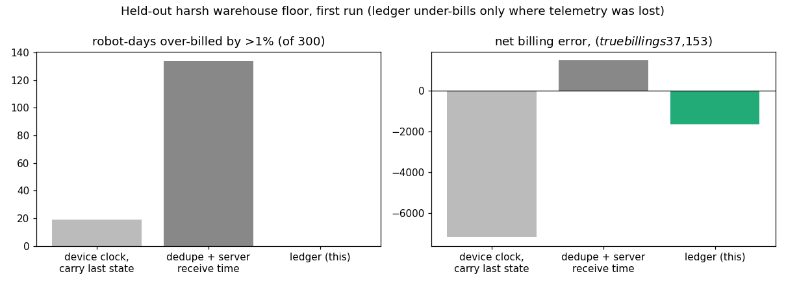

# Robot-hour metering ledger for robots-as-a-service

> Unofficial prototype by Kushagra Pratap Singh. Not affiliated with Eden Robotics.
> All telemetry is simulated. Contract terms, operator cost and energy cost are illustrative.

## The problem
Eden rents robots by the hour: "Robots as a Service ... Starting at $10/hour", 24/7, $0 setup ([edenrobotics.ai](https://edenrobotics.ai)). Customers "pay for the robots based on usage" ([YC](https://www.ycombinator.com/companies/eden-robotics)). So the bill is only as good as the robot's telemetry, and warehouse telemetry is messy:
- **Clocks reset.** Device clocks drift, and after a reboot the clock can fall back hours.
- **Data arrives late or not at all.** Wi-Fi dead zones delay uploads, and drop data once the on-robot buffer fills.
- **Events arrive twice.** Retries upload the same event again.

A bill built straight from that log is wrong in both directions. Over-billing starts disputes; under-billing loses money at a $10/hour price point. Margin also depends on how many minutes humans spend teleoperating, so those minutes have to be counted correctly.

## What I built
`meter/` (stdlib):
- **`sim.py`** is a simulator of 24/7 robot days. The true states are WORKING, TELEOP (remote-operator assist), WAITING (customer-caused), FAULT, CHARGING and OFF. It emits telemetry the way a robot would:
  - STATE events and 1-min heartbeats, stamped with the **device** clock and a per-boot sequence number;
  - SYNC pairs (device time, server time) every 30 min while online.

  It also breaks that telemetry:
  - clock offset and drift, with a clock reset on reboot;
  - dead zones, with buffered late upload and a 40-event buffer that drops the oldest events;
  - duplicate retries and out-of-order arrival.
- **`ledger.py`** builds the timeline in four steps:
  1. Dedupe by (boot, sequence).
  2. Fit each boot's clock from its SYNC pairs (Theil–Sen offset + drift). A boot that never synced is bounded by receive times, since an event can't arrive before it happened.
  3. Sort into a timeline.
  4. Mark any heartbeat gap over 3 min as **UNKNOWN**. Unknown time is never billed silently; it is reported.

  Then it produces the invoice:
  - **usage** contracts bill WORKING + TELEOP time;
  - **shift** contracts bill availability (shift minus FAULT, UNKNOWN and charging over a 12% allowance), with a 10% credit below 95% availability.

  Margin per robot-day and per site = revenue − teleop minutes × operator cost − energy.
- **Baselines:**
  - **device clock:** device timestamps as-is, no dedupe, last state carried across gaps;
  - **receive time:** dedupe, but stamp events with server receive time, the common shortcut.

## Results: held-out, first run
300 robot-days (6 sites × 5 robots × 10 days) on a harsher floor that was never run during development. Dead zones run up to 70 min, so the buffer overflows and data is lost. There are more reboots, clocks reset by up to a day, drift is larger and retries are more frequent. The config was frozen in git before the run (`heldout/config.json`, commit e5f649d). Nothing was changed after. Raw output: `out/heldout_first_run.json`.

| | Robot-days over-billed > 1% | Net error | Abs error | Teleop-min error |
|---|---|---|---|---|
| device clock, carry last state | 19 | −$7,160 | $7,762 | 1,835 |
| dedupe + server receive time | 134 | +$1,484 | $2,678 | 2,647 |
| **ledger (this)** | **0** | **−$1,638** | **$1,638** | **258** |

True billings: $37,153.



**What the ledger's error is.** All of its error is under-billing. 11,155 minutes were UNKNOWN because no telemetry survived the dead zone, and 8,908 of those were really billable work. Only 204 minutes in total were placed in the wrong state. The ledger doesn't invent hours it can't prove; it lists the UNKNOWN windows on the invoice, so they can be settled by contract.

**What-if, not part of the result above:** the same held-out floor with a 120-event buffer on the robot (2 hours of heartbeats, a few KB) leaves 123 UNKNOWN minutes and a net error of $0, still with 0 over-billed days. **The cheapest fix for lost revenue is a bigger on-robot buffer, not smarter billing.**

**Limits**
- Simulated telemetry and states. Real Theta OS/Interlink event schemas will differ. The ledger needs a boot id, a sequence number, heartbeats and occasional time-sync pairs.
- The contract terms (charging allowance, SLA, operator $/min, energy) are illustrative.
- Not handled: a robot moved between sites mid-day; partial-hour rounding rules; taxes.

## Run it
```
python demo.py                  # one robot-day: 3 boots, clock reset, 30 duplicates, dead zones -> three bills vs truth
python evaluate.py heldout      # the table above
python -m unittest discover tests
```
Python 3.10+, no dependencies (matplotlib only for `docs/plot.py`).
